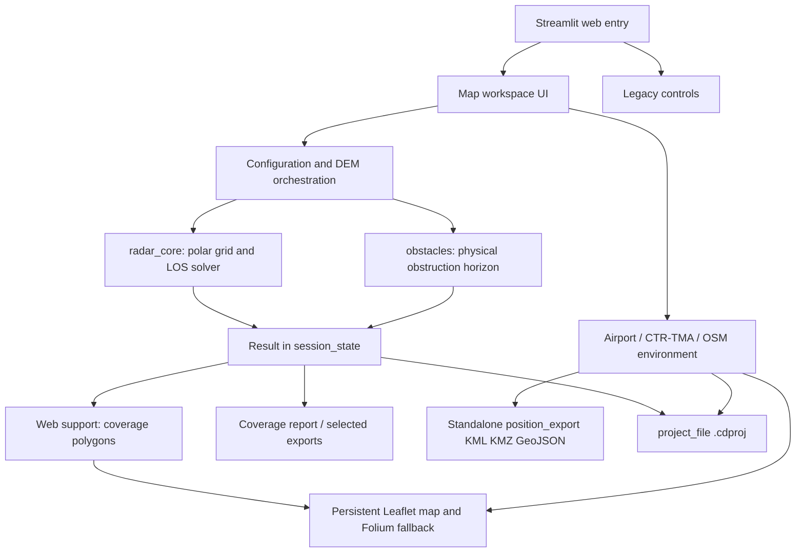

# COVERAGEDIAGRAMS — Software Development Documentation

**Document ID:** CD-SDD-001  
**Revision:** 1.0 (baseline audit, 2026-11-09)  
**Language:** Czech; code/API identifiers preserved in English  
**Repository:** `matykropac/COVERAGEDIAGRAMS`  
**Baseline:** `main` after PR #26 (provider failover) and PR #25 (export menu)  
**Document status:** implementation-derived engineering baseline, **not** a certification or formal safety assessment.

## 1. Purpose and scope

COVERAGEDIAGRAMS is a geospatial radar coverage workbench for preliminary PSR (RL-2000), SSR and PAR-NG studies. The software combines DEM-sampled line of sight with an antenna model, vector obstacles, runway geometry, airspace reference boundaries, visual map controls, portable project archives and customer/report exports. It can also export airport/airspace/obstacle layers without computing radar coverage.

The documentation is structured as a tailored software documentation set informed by:
- **ISO/IEC/IEEE 42010:2022**: architecture description (stakeholders, concerns, views, relations and rationale);
- **ISO/IEC/IEEE 29148:2018**: requirements engineering (identifiable, verifiable requirements);
- **ISO/IEC/IEEE 15289:2019**: life-cycle documentation information items;
- **ISO/IEC/IEEE 12207:2017**: software life-cycle process organization;
- **ISO/IEC 25010**: software product quality concerns (correctness, reliability, performance, security, maintainability, portability).

These documents **use the above standards as references; no claim of full compliance, accreditation or assurance** is made.

## 2. Documentation set

| ID | Artifact | Contents |
|---|---|---|
| CD-SDD-001 | this document | scope, terminology, architecture, interfaces, data, security, decisions |
| CD-SDD-002 | [DEVELOPMENT_AND_OPERATIONS.md](DEVELOPMENT_AND_OPERATIONS.md) | build, deployment, credentials, maintenance, QA, troubleshooting |
| CD-SDD-003 | [SOURCE_CODE_REVIEW.md](SOURCE_CODE_REVIEW.md) | source file catalogue, function-level trace, observed defects and technical debt |
| CD-SDD-004 | [REQUIREMENTS_AND_VERIFICATION.md](REQUIREMENTS_AND_VERIFICATION.md) | requirement IDs, acceptance criteria, evidence and missing tests |

## 3. Stakeholders, needs, and trust boundaries (ISO 42010-inspired)

- Radar engineers: parameter correctness, interpretable coverage and source provenance.
- System engineers and presales: repeatable site studies and customer-ready reports.
- GIS analysts: WGS84 vector interoperability and preservation of attribution/height reference.
- Maintainers: testable modules, reproducible exports and deployable dependency versions.
- Security/data custodians: controlled API keys, untrusted import validation and bounded third-party requests.

**Trust boundaries:**
1. `Streamlit` application and `st.session_state` are user-session UI state, not durable storage.
2. Online OpenTopography/OpenAIP/Overpass/OurAirports/Microsoft/ADS-B are external, variable, and may be restricted/unavailable; results are **reference data**, not operational NOTAM or certified obstacle data.
3. `*.cdproj` is a portable project snapshot containing calculated matrices; validate imported metadata/arrays before reuse.
4. Browser-hosted Leaflet and external tile servers form a separate rendering and credentials boundary.
5. KML/KMZ/GeoJSON/PDF/PNG/ZIP are generated deliverables; numerical fidelity depends on original DEM/grid and source quality, **not output DPI**.

## 4. Architecture and runtime views

**Component responsibilities (normative design intent):**
- `radar_core.py`: physics, DEM retrieval/sampling, result matrices, antenna patterns, scientific/geospatial plotting.
- `obstacles.py`: validation of manual/catalog obstacles and their effect on LOS.
- `map_workspace.py`: Streamlit session workflow, cached recomputation and panels MAPA/PŘEKÁŽKY/RADAR/POZICE.
- `persistent_leaflet.py` + `assets/persistent_leaflet.js`: browser-side persistent map, marker and vector overlays, UI event bridge.
- `environment_layers.py`: OSM/Overpass geodata, height parsing and standalone environmental overlays.
- `airport_geometry.py`: OurAirports runway endpoint lookup, geodesic centerline, displaced thresholds and approach bearing.
- `airspace_geometry.py`: OpenAIP vector CTR/TMA query, validation, height reference labels and GeoJSON.
- `position_export.py`: KML/KMZ/GeoJSON selected map layers without radar result.
- `project_file.py`: portable calculated project save/load; POZICE metadata restored by workspace layer.
- `coverage_report.py`: customer PDF report with diagrams and overview, high-DPI raster figures.
- `selected_export.py`: ZIP assembly of selected legacy/modern outputs.

## 5. Behavior / processing sequences

### 5.1 Radar calculation
1. Validate user `Config` (location, radar mode, beam, grid, distance and height reference).
2. Build polar azimuth/distance axes; PAR uses ±15° around specified TRUE bearing; PSR/SSR cover 360°.
3. Fetch/select source DEM and sample on polar grid; gaps cause unknown points to remain unknown along each affected radial.
4. Compute effective Earth geometry and radar horizon, upper/lower angular bounds.
5. Apply antenna-specific gain/range envelope to determine visibility; for SSR use two-link illustrative model, for PAR `TRACKING` or `FIXED_3D` with optional illustrative Albersheim model.
6. Apply up to 1000 validated physical obstacle footprints; update result metadata and signature.
7. Commit a completed result only after all preceding steps have succeeded. For cached recomputation, create a fresh result from archived terrain before replacing prior session result.

### 5.2 Map-only workflow (without computation)
1. Enter airport ICAO in POZICE; resolve runway endpoints and azimuth, retaining raw source provenance.
2. Request CTR/TMA as vector polygons with lower/upper vertical references.
3. Import/query 2 km surroundings from Overpass; downloaded heights may be absent and must not be inferred.
4. Edit or hide individual objects in the appropriate editor.
5. Export selected layers in MAPA → EXPORTNÍ CENTRUM → KML/KMZ/GeoJSON.
6. Export folders and features in **EPSG:4326 WGS84**, with coordinates ordered longitude,latitude in files; UI editor uses latitude,longitude.

### 5.3 Reports
- Export PDF/PNG/QuickReport/ZIP is available after a radar result is present.
- Standalone position-layer KML/KMZ/GeoJSON is available before any radar computation.
- High-resolution 600 DPI means output rendering density, **not** finer physical radar sampling.

## 6. Engineering data model

| Entity | Owning module | Essential fields / semantics |
|---|---|---|
| Radar config | `radar_core.Config` | `lat,lon,antenna_agl,range_km,step_m,az_step,k,min_elev,max_elev,target_m,reference,antenna_tilt_deg,beam_mode,radar_mode,bearing_deg` |
| Radar result | `radar_core.solve` | `az,distance,terrain,lower,upper,status,target,antenna,site_height,config,horizon,known,antenna_pattern` |
| Obstacle | `obstacles.py` | point/arc/polygon; horizontal footprint, `height_m` in AGL, source |
| Airport runway | `airport_geometry.py` | dual endpoints, displaced thresholds, centerline/midpoint, TRUE heading, length/width, source |
| CTR/TMA | `airspace_geometry.py` | GeoJSON geometry, type, class, lower/upper text/reference, source, visibility |
| Environment object | `environment_layers.py` | Building/Forest/Tower, ring, `height_m` optional, quality, OSM source ID |
| Layer export | `position_export.py` | GeoJSON Features with `layer`, `name`, source and optional height attribute |
| Project archive | `project_file.py` | compressed result arrays, config, levels, obstacles, source_ui metadata, validation |
| Map UI | `map_workspace.py` | Streamlit session state `ws_*`, previous result and cached geometry |

**Units:** distance: metres inside physical calculations; nautical miles for aviation display; positions WGS84; horizontal azimuth TRUE degrees clockwise from north; altitude references explicitly AGL or AMSL; a CTR/TMA vertical bound with unknown reference cannot be silently converted to AMSL.

## 7. Assumptions and physical-model limitations

The results are preliminary engineering predictions, **not** proof of operational radar performance, flight procedure safety, obstacle certification, or AIP/NOTAM status. Key limitations:
- Earth curvature is handled by configurable effective Earth radius factor `k`; no atmospheric time-varying propagation.
- Missing terrain and incomplete data are unknown; not automatically visible.
- No certified propagation, diffraction, multipath, CFAR, clutter, full Pd/Pfa validation or measured dwell-time evidence.
- PAR `TRACKING` is a simplified ideal boresight scan with configurable steering loss; `FIXED_3D` interpolates the static supplied antenna grid. The Albersheim mode is an **approximation** using assumed reference SNR; it does not certify specific PAR-NG detection.
- CTR/TMA layers are plan-view polygons, not 3D airspace solids; vertical limits are attributes.
- Community runway/AIP-like data and nearby OSM objects must be compared to official aeronautical and surveyed sources for contractual/operational outputs.

## 8. Reproducibility, cache and provenance

- Expensive DEM sampling and polar calculations can be held in session memory. Changing obstacles should use fresh solver execution over the retained sampled DEM, not reuse already obstacle-masked visibility.
- The prior result must survive a failed recomputation or failed external provider request.
- Streamlit data cache is **ephemeral** and is not a substitute for `.cdproj`.
- Downloaded CTR/TMA and OSM datasets must retain source attribution and collection timestamp; source changes can alter results on a later run.
- For repeatability, record commit SHA, dataset, DEM provenance, model settings, height reference, time and exact export selection.
- Export metadata, hashes and deterministic test fixtures should be expanded for audit-grade reproducibility (see findings CD-SDD-003).

## 9. Security, licensing and operations

- Never store real API keys in repo, generated PDF, KML, `.cdproj`, logs or screenshots.
- `OPENTOPOGRAPHY_API_KEY` authorizes DEM fetch; `OPENAIP_API_KEY` is used for raster tiles and can be exposed to browser network requests. For OpenAIP **vector** API, `OPENAIP_DATA_API_KEY` is preferred; HTTP 401/403 can mean account scope or remote access policy; changing code cannot grant provider permissions.
- OSM Overpass fallback uses allowlisted public hosts, bounded responses and a timeout. Never use arbitrary user-provided endpoints.
- Generated layer sources: OurAirports / OpenAIP / OSM; check attribution and dataset licenses before redistribution, especially commercial/customer deliveries.
- Validate all imported ZIP/GeoJSON/project material, coordinate ranges and sizes. Untrusted metadata must not be executed as code.

## 10. Architecture decisions / rationale

| ADR | Decision | Trade-off |
|---|---|---|
| ADR-001 | Keep physical radar solver independent of map-only POZICE layers | Maps remain usable during DEM/API outages; avoid accidental coupling |
| ADR-002 | Store terrain and project data in portable .cdproj | Repeatability without new download; large files require bounded validation |
| ADR-003 | Use persistent Leaflet rather than recreating entire map on each UI rerun | Better UI performance; custom JS + Streamlit bridge adds testing complexity |
| ADR-004 | Preserve uncertain geodata height as null | Avoid engineering false precision; some data cannot be used in calculation |
| ADR-005 | Keep original report/PNG export and independent map-only KML/KMZ | Different products and prerequisites, share coordinate provenance |
| ADR-006 | Offer multiple Overpass hosts and explicit OpenAIP Core API authorization diagnostics | Improves availability without bypassing account restrictions |

## 11. Maintenance ownership and change control

A new feature is complete only when: requirement ID, implementation path, model behavior, input validation, unit test, meaningful failure handling, documentation and customer impact have been reviewed. Physics-affecting changes also require regression against independently validated terrain/pattern fixtures and desktop/web parity.

**Document caveat:** This baseline is code-inspected for the identified modules/functions, with outstanding defects explicitly recorded; it does **not** claim an exhaustive manual review of every generated data literal, desktop UI branch, asset or historical script. See CD-SDD-003 for tracked review coverage and blockers.

## 12. Standards / further reference

- ISO/IEC/IEEE 42010:2022 — https://webstore.iec.ch/en/publication/80194
- ISO/IEC/IEEE 15289:2019 — https://www.iso.org/standard/74909.html
- ISO/IEC/IEEE 29148:2018 — requirements engineering
- ISO/IEC/IEEE 12207:2017 — software life cycle processes
- ISO/IEC 25010 — software product quality model
